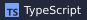
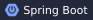
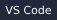
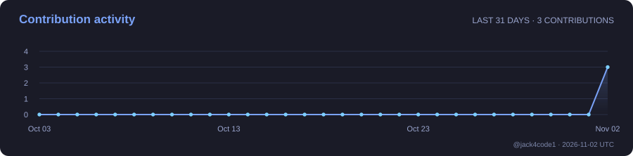

  <picture>
    <source media="(max-width: 600px)" srcset="./assets/banner-mobile.svg" />
    
  </picture>

  <picture>
    <source media="(max-width: 600px)" srcset="./assets/typing-mobile.svg" />
    
  </picture>

## About Me

Hi, I'm Jack — also known as **QuietNova**.

**AI Engineer / Software Developer**

I'm passionate about artificial intelligence and software engineering. I enjoy exploring emerging technologies, building practical tools, and turning ideas into reliable software.

## Areas of Interest

Directions I'm interested in and continue to explore:

  <code>AI Agents &amp; Agent Systems</code> · <code>LLM Applications</code> 
  <code>LLM Training &amp; Fine-tuning</code> · <code>LLM Inference &amp; Optimization</code> 
  <code>AI Coding &amp; Developer Tools</code> · <code>Backend Engineering</code> 
  <code>Software Architecture</code> · <code>Distributed Systems</code>

## Tech Stack

Technologies I've used or explored, and continue to learn.

**Languages**

  
  
  
  
  

**AI & Machine Learning**

  
  
  
  
  

**Backend & Infrastructure**

  
  
  
  
  
  

**Tools**

  
  
  
  

## GitHub Activity

  
  

  

  <picture>
    <source media="(max-width: 600px)" srcset="https://raw.githubusercontent.com/jack4code1/jack4code1/output/activity-mobile.svg" />
    
  </picture>

Real GitHub activity. Language distribution reflects public code, not proficiency.

### Contribution Snake

<picture>
  <source media="(prefers-color-scheme: dark)" srcset="https://raw.githubusercontent.com/jack4code1/jack4code1/output/snake-dark.svg" />
  <source media="(prefers-color-scheme: light)" srcset="https://raw.githubusercontent.com/jack4code1/jack4code1/output/snake.svg" />
  
</picture>

A little motion, powered by my contribution history. Updated daily.

---

<strong>Stay curious. Keep building. Never stop exploring.</strong>

<a href="https://github.com/jack4code1">QuietNova · @jack4code1</a>

