  <picture>
    <source media="(max-width: 600px)" srcset="./assets/banner-mobile.svg" />
    
  </picture>

  <strong>你好，我是 QuietNova 👋</strong> 
  河南大学研三 · 做过计算机视觉目标检测 · 关注 AI Agent 与大模型应用

  <a href="https://github.com/jack4code1/mewcoder">MewCode</a> ·
  <a href="https://github.com/jack4code1/XG2JD">校园生活服务与营销平台</a>

## 关于我

本科和硕士均就读于河南大学，目前研三。做过一些计算机视觉方向的目标检测工作；现在对 AI Agent、大模型工程和 AI 应用开发很感兴趣，喜欢通过实际项目学习和探索。

## 精选项目

### [MewCode](https://github.com/jack4code1/mewcoder)

基于 **Python + Textual** 的终端 AI 编程助手，将模型对话、项目上下文、文件与命令工具整合在一个终端界面中。支持多模型接入、会话恢复、工具审批与项目记忆。

### [校园生活服务与营销平台](https://github.com/jack4code1/XG2JD)

基于 **Java + Spring Boot** 的校园场景后端项目，涵盖店铺与商品查询、用户点评、优惠券秒杀和订单处理。使用 Redis Lua 完成抢券校验，并通过 RabbitMQ 处理异步订单与异常补偿。

## 技术与兴趣

- **计算机视觉：**目标检测
- **AI 应用：**AI Agent、大模型工程、AI 编程工具
- **项目技术：**Python、Java、Spring Boot、Redis、RabbitMQ、Textual

## GitHub 足迹

<picture>
  <source media="(prefers-color-scheme: dark)" srcset="https://raw.githubusercontent.com/jack4code1/jack4code1/output/snake-dark.svg" />
  <source media="(prefers-color-scheme: light)" srcset="https://raw.githubusercontent.com/jack4code1/jack4code1/output/snake.svg" />
  
</picture>

Stay curious. Keep building. Never stop exploring.

